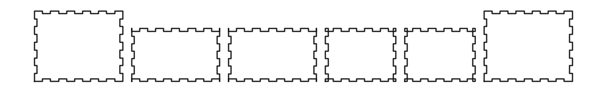
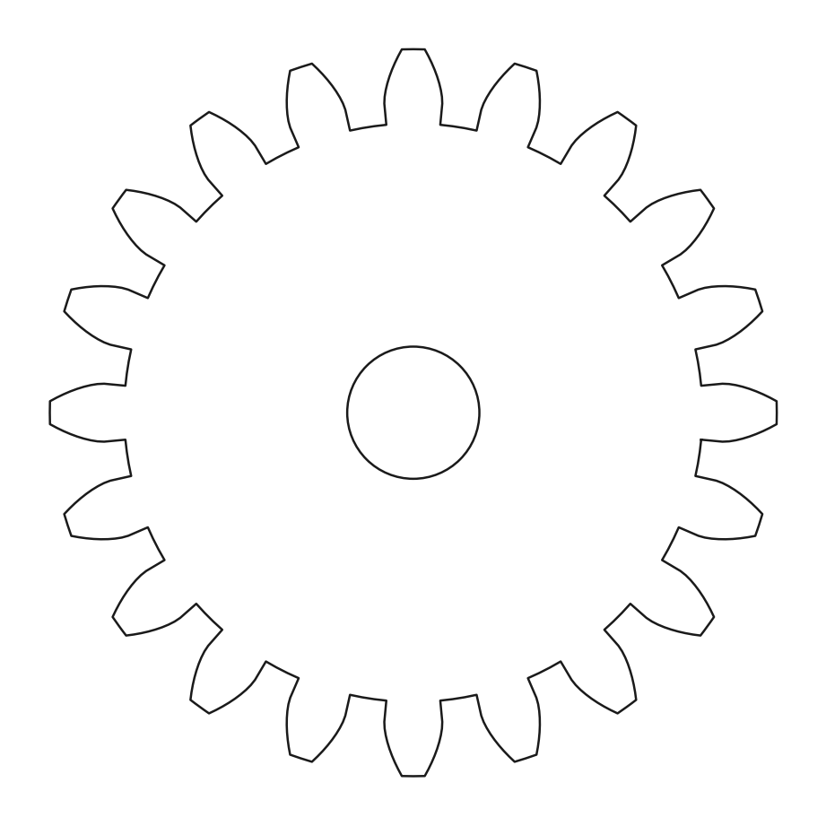
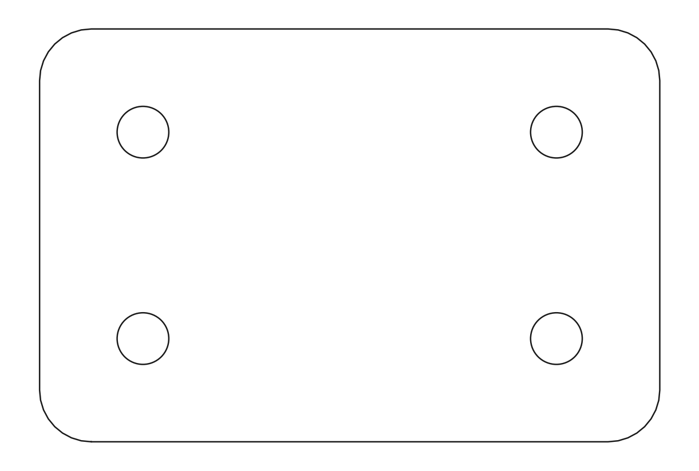

# LaserCut DXF Generator

Generate ready-to-cut DXF files for laser cutting & CNC: finger-joint boxes, involute spur gears, brackets. Pure Python, zero dependencies.

[](https://opensource.org/licenses/MIT)
[](https://www.python.org/)
[]()

> The only zero-dependency Python CLI that generates finger-joint boxes, true involute spur gears and brackets as ready-to-cut DXF files, with kerf compensation.





## Download a ready-made DXF — no install needed

Just want to cut something right now? Download a finished file and open it in LightBurn, LaserCAD or AutoCAD:

- [box_100x80x60_t3.dxf](examples/box_100x80x60_t3.dxf) — finger-joint box 100 × 80 × 60 mm, 3 mm material
- [gear_m2_z20.dxf](examples/gear_m2_z20.dxf) — involute spur gear, module 2, 20 teeth, 8 mm bore
- [bracket_60x40.dxf](examples/bracket_60x40.dxf) — mounting bracket 60 × 40 mm, 4 holes Ø 5 mm

## Quickstart

```bash
git clone https://github.com/eslam-tohamy2026/lasercut-dxf-generator.git
cd lasercut-dxf-generator
python -m dxfgen box --length 100 --width 80 --height 60 --thickness 3 --output box.dxf
python -m dxfgen gear --module 2 --teeth 20 --bore 8 --output gear.dxf
```

No dependencies, no build step, no install. Python 3.9 or newer is all you need.

## Features

- **Finger-joint box** — six panels laid out flat in one file, joints that actually fit: every shared edge is complementary (tab meets slot), and the finished box measures exactly the size you asked for.
- **True involute spur gear** — real involute flanks (20° pressure angle), correct pitch, root and tip diameters, centre bore. Not a circle with bumps.
- **Mounting bracket** — rounded-corner plate with four evenly spaced holes.
- **Kerf compensation** — the laser burns away a thin line of material while cutting. Pass `--kerf` and the tool widens the tabs and narrows the slots by exactly that amount, so the finished joint fits first time instead of rattling loose.
- **Clean DXF output** — DXF R2000 (AC1015), closed polylines on layer 0, millimetres. Opens in LightBurn, LaserCAD, AutoCAD, LibreCAD and FreeCAD.
- **Verified output** — every example file is read back and checked automatically (see `verify_examples.py`); the test suite re-derives the gear geometry from the involute formula independently.

## Usage

### Box

```bash
python -m dxfgen box --length 100 --width 80 --height 60 --thickness 3 --output box.dxf
```

| Option | Meaning |
|---|---|
| `--length` | Outer length in mm |
| `--width` | Outer width in mm |
| `--height` | Outer height in mm |
| `--thickness` | Material thickness in mm |
| `--kerf` | Laser kerf in mm (default 0) |
| `--output` | Output `.dxf` file |

Finger count per edge is chosen automatically (target finger width is max(3× thickness, 10 mm), always an odd count so the pattern starts and ends with a tab).

### Gear

```bash
python -m dxfgen gear --module 2 --teeth 20 --bore 8 --output gear.dxf
```

| Option | Meaning |
|---|---|
| `--module` | Gear module in mm (pitch diameter = module × teeth) |
| `--teeth` | Number of teeth (≥ 6) |
| `--bore` | Centre bore diameter in mm (0 for none) |
| `--pressure-angle` | Pressure angle in degrees (default 20) |
| `--output` | Output `.dxf` file |

Tip diameter = module × (teeth + 2), root diameter = module × (teeth − 2.5).

### Bracket

```bash
python -m dxfgen bracket --width 60 --height 40 --corner-radius 5 --hole-dia 5 --hole-margin 10 --output bracket.dxf
```

| Option | Meaning |
|---|---|
| `--width` | Plate width in mm |
| `--height` | Plate height in mm |
| `--corner-radius` | Rounded corner radius in mm |
| `--hole-dia` | Hole diameter in mm |
| `--hole-margin` | Distance from each edge to the hole centres in mm |
| `--output` | Output `.dxf` file |

Run `python -m dxfgen --help` or `python -m dxfgen <command> --help` for the full options.

## Kerf, in plain language

A laser doesn't cut a zero-width line — it burns away a strip of material about as wide as the beam (the *kerf*, typically 0.1–0.3 mm depending on the machine and material). If you cut a tab and a slot at exactly the same drawn size, the finished tab comes out thinner and the slot comes out wider, so the joint is loose. This tool compensates: with `--kerf 0.2`, tabs are drawn 0.2 mm wider and slots 0.2 mm narrower, so after the laser takes its share both come out at exactly the size you asked for. Measure your machine's kerf once (cut a 20 mm square and measure it) and reuse the number.

## Need a custom part designed for production?

Hire me on Fiverr: https://www.fiverr.com/eslam_engineer — SolidWorks 3D modelling, PDF/sketch → AutoCAD DWG & DXF, CNC/laser-cut files ready for production, Excel VBA automation.

## Contributing

Found a problem or want another generator? Open an issue with the command you ran and the measurements you expected. Pull requests are welcome — please add a test for new geometry and run the suite first:

```bash
.venv/bin/python tests/test_dxfgen.py   # 10 checks, all must pass
.venv/bin/python verify_examples.py    # independent ezdxf round-trip check
```

## Licence

MIT — see [LICENSE](LICENSE). Free for personal and commercial use.
